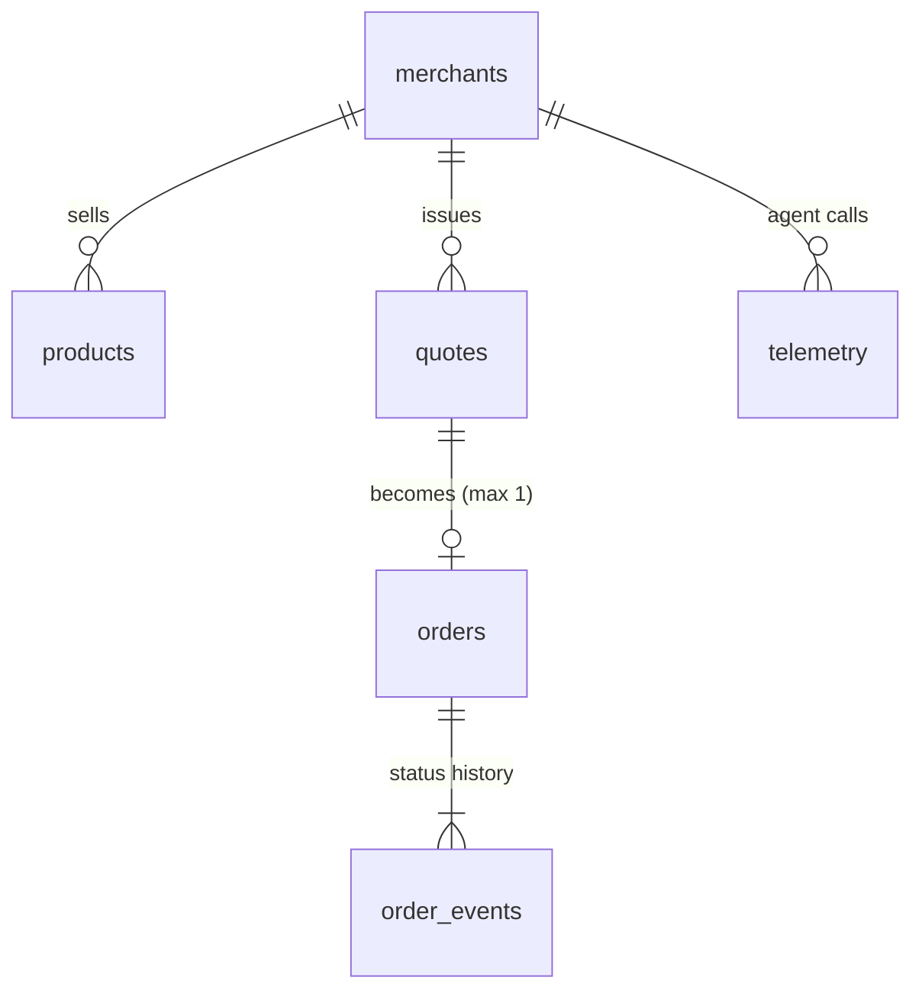

# Data model

SQLite (WAL). Schema: [`database/migrations/001_init.sql`](../../database/migrations/001_init.sql).
Money is integer minor units; times are ISO-8601 UTC text.

| Table          | Holds                                                                        | Write rule            |
| -------------- | ---------------------------------------------------------------------------- | --------------------- |
| `merchants`    | name, currency, PayPal payee email, spec, spec status                        | updatable             |
| `products`     | catalog, raw + agent description, firewall status; FTS5 index `products_fts` | updatable (re-upload) |
| `quotes`       | passing quotes only: locked terms, guardrails sent, expiry, hash             | insert-only (trigger) |
| `orders`       | quote ↔ PayPal order, copied hash, approve URL; `quote_id` UNIQUE            | insert-only (trigger) |
| `order_events` | status history; current status = latest row                                  | insert-only (trigger) |
| `telemetry`    | one row per agent call                                                       | insert-only (trigger) |

Why insert-only and hashed: [ADR-0006](../adr/0006-quote-hash-and-insert-only-records.md).

**Search index.** `products_fts` (FTS5, porter stemming) holds name, agent description and category,
keyed by `(merchant_id, sku)` and kept in sync by triggers; only text changes reindex, so stock updates
stay cheap. Migration 002 replaced the original rowid link, because the implicit rowid of a table with a
composite primary key may change on VACUUM.

**Telemetry errors.** `telemetry.error_code` (002) holds the error code of failed agent calls
(`INVALID_INPUT`, `MERCHANT_NOT_FOUND`, …).
