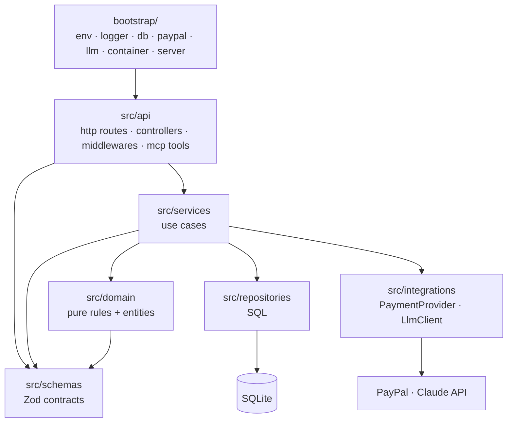
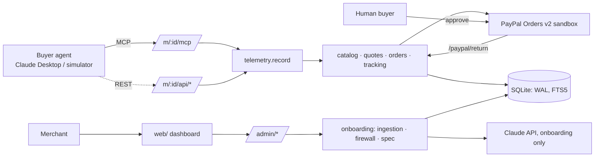

# Architecture overview

**One Node service hosts every merchant.** It is split into a composition root (`bootstrap/`) and layered
application code (`src/`). The LLM runs only at onboarding; the money path is pure rules over SQLite.

## Repository layout

```
bootstrap/        composition root: env, logger, database connection, PayPal + LLM clients,
                  dependency wiring (container.ts), HTTP server, main.ts entry point
src/
  api/            transport layer: HTTP (routes → controllers → middlewares) and MCP (tools)
  services/       use cases: onboarding, catalog, quotes, orders, tracking, telemetry, dashboard
  domain/         pure business rules and entities: guardrails, quote hash, money, firewall rules
  repositories/   data access; the only place SQL lives
  integrations/   adapters to external systems behind interfaces (payments/, llm/)
  schemas/        Zod request/response contracts (REST, MCP, OpenAPI all come from here)
  shared/         errors, clock, ids
database/         SQL migrations + seed CSV
web/              merchant dashboard (React + Vite + AG Grid), built into dist/web
scripts/          operational scripts: migrate, seed
tools/simulator/  scripted buyer agents (dev tool, not part of the service)
tests/            unit/ (domain), integration/ (HTTP + DB), helpers/, fixtures/
storage/          runtime SQLite file (git-ignored)
```

## Layers and dependency rule



Arrows point at what a layer may import. Enforced by `eslint.config.js` (`pnpm lint` fails otherwise):

| Layer                                                    | May not import                                                              |
| -------------------------------------------------------- | --------------------------------------------------------------------------- |
| everything in `src/`                                     | `bootstrap/` (dependencies arrive as parameters)                            |
| `api/`                                                   | `repositories/` (always go through a service)                               |
| `services/`                                              | `api/`                                                                      |
| `services/quote.service.ts`, `services/order.service.ts` | `integrations/llm`, `@anthropic-ai/*` (ADR-0002)                            |
| `repositories/`, `integrations/`                         | `api/`, `services/`                                                         |
| `domain/`, `schemas/`, `shared/`                         | any other layer, or I/O libraries (express, SQLite, PayPal, Anthropic, MCP) |

## Components at runtime



- **Adapters are thin.** MCP tools and REST controllers parse input with `src/schemas` and call the same
  services, so both channels behave the same.
- **One telemetry choke point.** Every agent call goes through `telemetry.record()`: one row per call (NFR-06).
- **Tenant by path.** Every store route is scoped by `merchant_id`; every query filters on it.
- **Ports for the outside world.** Services depend on `PaymentProvider` and `LlmClient` interfaces; the
  concrete clients are created in `bootstrap/` and replaced with fakes in tests.

## Startup sequence (`bootstrap/main.ts`)

1. `loadEnv()` reads `.env`, validates with Zod, exits on bad config.
2. `createLogger()` (pino, JSON).
3. `connectDatabase()` + `runMigrations()`.
4. `createPaymentProvider()` and `createLlm()` (each degrades safely when credentials are missing).
5. `buildContainer()` wires repositories → services.
6. `createHttpApp()` mounts middleware, routes, dashboard; `listen()`; graceful shutdown on SIGINT/SIGTERM.

More: [request-flows.md](request-flows.md) · [data-model.md](data-model.md) · [traceability.md](traceability.md)
