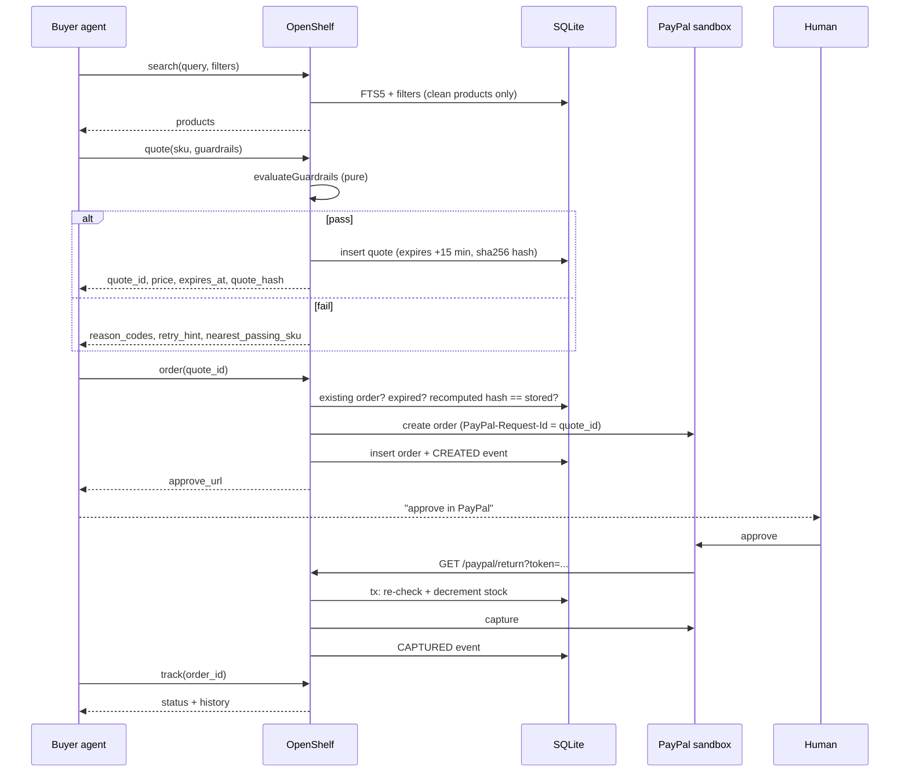

# Request flows

## Buyer agent: search → quote → order → approve → capture → track



Each agent call above writes exactly one `telemetry` row. A failed quote is not stored in `quotes`; its
reasons live in telemetry and feed the drop-off view.

## Merchant onboarding

```mermaid
sequenceDiagram
  participant M as Merchant (web/)
  participant S as OpenShelf /admin
  participant L as Claude API

  M->>S: POST /merchants (name, currency, PayPal payee email)
  M->>S: POST /catalog/preview (CSV, optional mapping)
  S->>S: csv-parse → mapColumns (synonyms + merchant corrections) → validate every row
  opt unmapped headers and LLM configured (step 9)
    S->>L: suggest mapping
  end
  S-->>M: mapping, missing columns, every row problem (row + header), sample
  M->>S: POST /catalog/commit (CSV + confirmed mapping)
  S->>S: same parsing; any problem → 422, nothing saved
  loop each product
    S->>S: firewall rules → sanitize agent-facing text
    opt rules pass and LLM configured (step 9)
      S->>L: injection verdict, then description rewrite
    end
  end
  S->>S: replace the catalog in one transaction
  opt step 9
    S->>S: template spec from src/schemas
    S->>L: enrich spec → validate (fallback to template on any failure)
  end
  S-->>M: StoreInfo: /m/{id}/mcp, /m/{id}/openapi.json, counts, flagged products
```

Nothing is written before the commit step. Flagged products are stored (raw text kept for audit) but never
returned by search.
