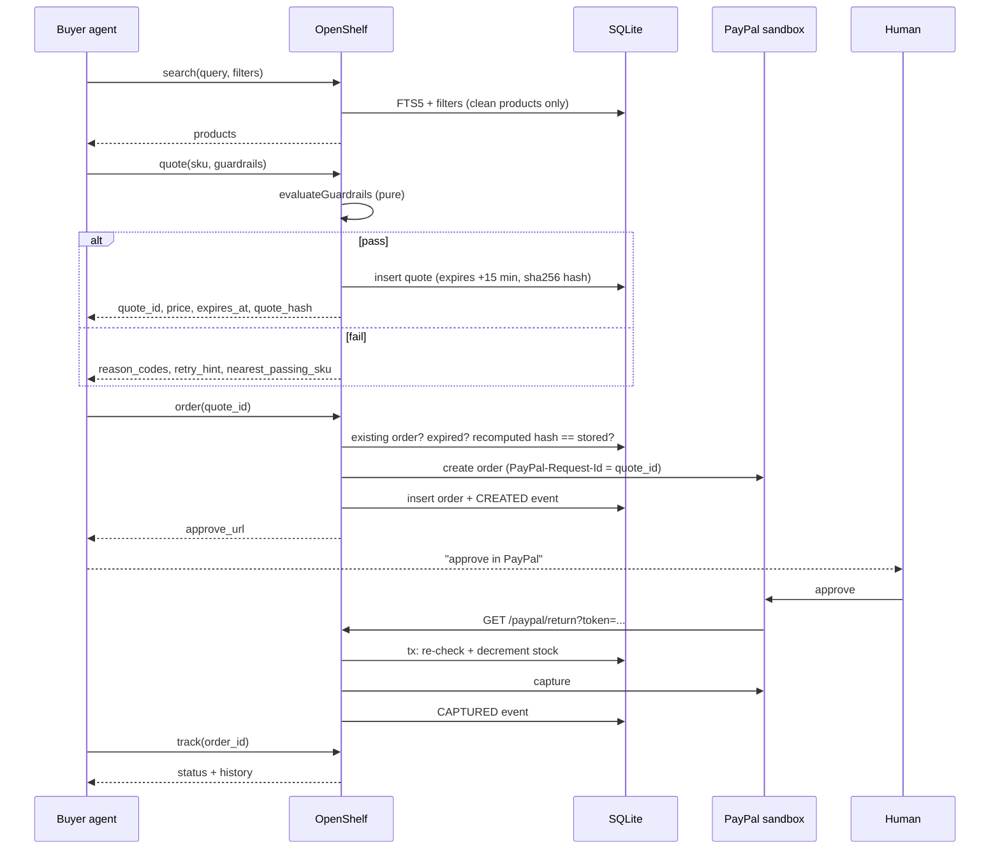
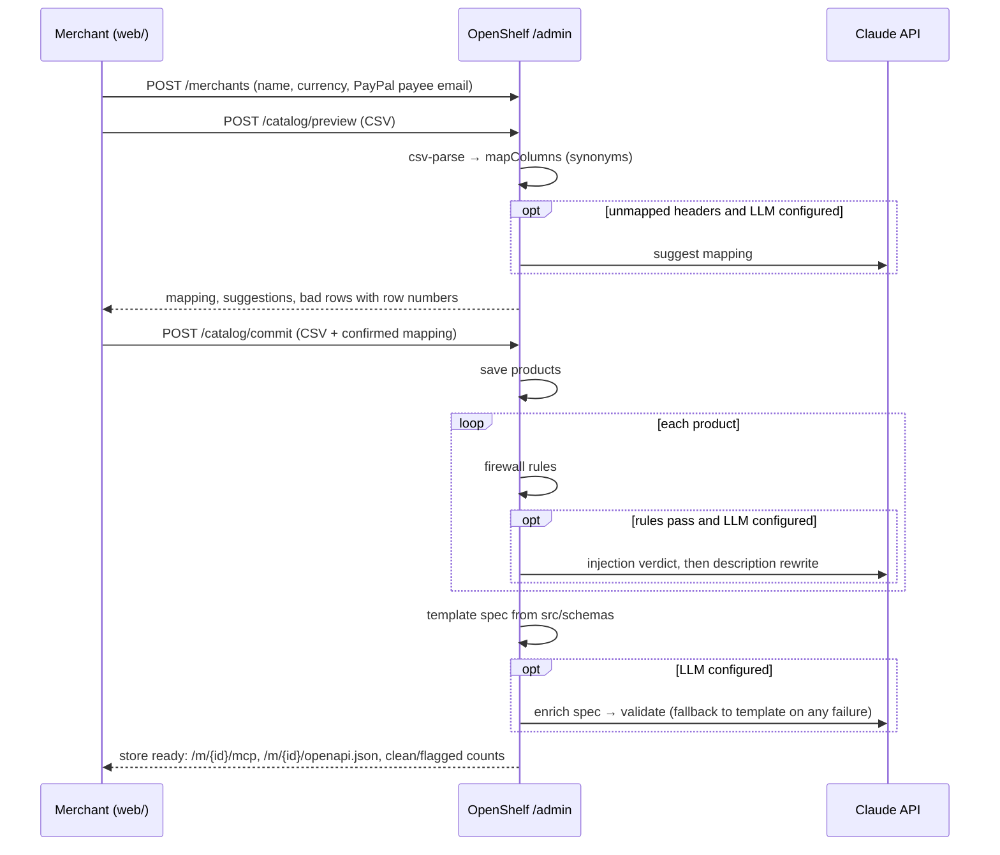

# Request flows

## Buyer agent: search → quote → order → approve → capture → track

Each agent call above writes exactly one `telemetry` row. A failed quote is not stored in `quotes`; its
reasons live in telemetry and feed the drop-off view.

## Merchant onboarding

